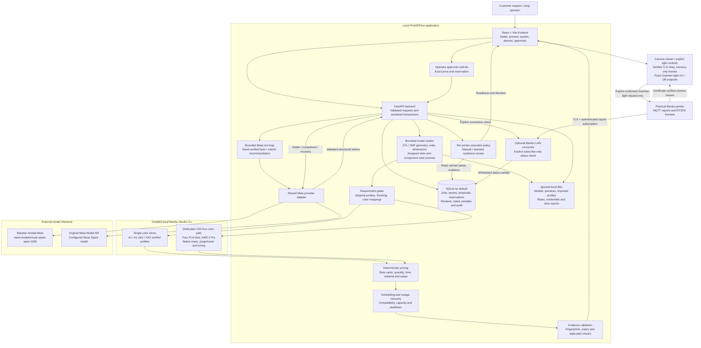

# Print3DFlow architecture

Current implemented architecture, including Meta provider selection, verified slicing, approval boundaries, execution readiness, and the read-only Bambu LAN connector.

## System diagram

Arrows show application data flow, not authorization to perform every operation. Meta has no physical printer commands or commitment tools. The connector authenticates and subscribes to reports but never publishes printer requests.

## Components and verification points

| Component | Responsibility | Source |
| --- | --- | --- |
| Operator workspace | Intake, model review, pricing/schedule review and approvals | [frontend/src/main.tsx](../frontend/src/main.tsx) |
| Job API and storage | Job lifecycle, pricing, proposals, serialized reservation commits and audit | [backend/main.py](../backend/main.py) |
| Model processing | Isolated geometry validation and normalized model/preview assets | [backend/model_processing.py](../backend/model_processing.py) |
| Native slicer integration | Imported profile validation and local Bambu Studio invocation | [backend/integrations.py](../backend/integrations.py) |
| Four-color quotes | Match the uploaded project, verify native results, create unselected candidates and approve mappings/exact price | [backend/multicolor.py](../backend/multicolor.py) |
| Cross-printer adviser | Independent verified slice/quote/schedule options and grounded Meta advice | [backend/comparison.py](../backend/comparison.py) |
| Recovery explanations | Validate Meta reason codes against deterministic recovery facts | [backend/recovery.py](../backend/recovery.py) |
| Production planner | Bounded read-only tools, validated recommendations and stale evidence handling | [backend/planner.py](../backend/planner.py) |
| Provider configuration | Fixed provider endpoints, separate credentials and hackathon model selection | [backend/meta_provider.py](../backend/meta_provider.py) |
| Execution readiness | Per-printer policy, physical check attestations and readiness blockers | [backend/execution.py](../backend/execution.py) |
| Printer connector | TLS certificate/serial identity verification and subscribe-only LAN status samples | [backend/printer_connector.py](../backend/printer_connector.py) |
| Visual bed review | Ephemeral evidence, image-specific consent, validated Meta classification and separate physical confirmation | [backend/bed_check.py](../backend/bed_check.py) |
| Camera and light controls | Local memory-only camera sessions and separately confirmed chamber-light requests | [backend/printer_view.py](../backend/printer_view.py) |

## Job and approval flow

1. Upload an STL or 3MF. The bounded worker validates geometry and reads dimensions, units and supported 3MF assignments. STL material/color requirements require user entry; unambiguous assigned 3MF slots can suggest editable requirements.
2. Optionally request Meta intake extraction. The operator reviews the structured draft and clarifications before submitting the job.
3. Requirement gates determine which quote paths are eligible. Material requests alone do not configure a printer/material profile. Unresolved mappings and custom finishing remain blockers for unsupported automated quote paths.
4. Run native single-color slicing, an explicitly labelled manual estimate where allowed, or the dedicated verified X2D four-color workflow. Native totals feed deterministic pricing. Four-color non-main purge/tower material and change overhead are included once, not added twice.
5. Review candidate prices and independently checked capacity. Comparison and four-color candidates do not select a price on generation. Comparison/four-color workflows require explicit exact-price approval, followed by separate reservation approval. The basic proposal workflow has its existing explicit approval control.
6. Request Meta planning or recovery advice. Its recommendations are checked against verified facts and never approve commitments. Stale evidence suppresses recommendations or rejects approval.
7. After a reservation is approved, review execution readiness. Confirm the physical artifact, material/mappings, sufficient filament, clear plate and local printer readiness. Readiness records never start a print.

## Meta runtime boundary

The provider adapter supports the original Meta Model API and Baseten-hosted Meta inference. Select the provider in local configuration; Baseten uses the fixed hackathon model `meta-models/muse-spark-open-1026`. The application does not require both providers at once.

Meta performs structured intake, cross-printer advice, outage recovery reasoning and production planning. The planner exposes only `check_job_readiness`, `read_verified_comparison` and `submit_plan`. It cannot slice, change a price, reserve capacity, send a customer message, run a shell or control a printer. The visible trail contains verified tool results; raw model reasoning is not displayed.

Data-sharing permissions differ by workflow. Intake sends request text and validated model metadata; cross-printer advice requires permission to share quote facts. Planning excludes customer text, models, filenames, printer names, rate cards and prices. Mesh files, credentials and imported printer settings remain local. Structured output and evidence validation fail closed on malformed or invented results.

## Execution and printer boundary

Manual is the default execution policy. Assisted mode adds readiness review; starting the physical print still happens at the printer. The server rejects automatic execution policy requests, and no remote-start endpoint exists.

The optional connector supports one explicitly configured printer at a time. It connects to a private LAN IPv4 address on MQTT TLS port 8883, validates the certificate chain and saved serial identity, authenticates using local credentials, and subscribes to that serial's report topic. The status adapter has no publish, upload, start, pause or stop path. A separate operator-only light endpoint publishes only a fixed chamber-light On/Off request after confirmation. Certificate failures have no insecure fallback.

A connection check waits for a non-retained status report with a recognized execution state. It stores only whitelisted state, progress, temperature and error-presence fields. Samples expire after 60 seconds; changed configuration invalidates them. This is an on-demand sample, not continuous monitoring. Fresh busy/error/unknown-error status blocks readiness. Assisted mode with a configured connector requires fresh telemetry. Bed clearance, physical filament mappings and sufficient material still require operator inspection. `FINISH` does not prove the plate is empty.

Operator readiness reviews expire after ten minutes or when their evidence changes. They do not change selected prices, reservations or job production status. The X2D connector was commissioned through a live authenticated, certificate-validated read-only status check; that does not verify every printer model, firmware, physical mapping or remote execution capability.

## Storage and deployment

The current MVP runs locally: FastAPI serves the built frontend and stores records in SQLite by default. The backend also supports a configured PostgreSQL connection, but fleet-scale deployment has not been validated. Models, previews, profiles, native artifacts and private reports use local file storage. Kubernetes, Redis and cloud object storage from the early design are not implemented dependencies.

The prototype is intended for a trusted local operator environment and is not a public multi-tenant service. Local `.env`, credentials, shop rates, imported profiles, model files, certificates and private reports are excluded from Git. The staged-file privacy checker scans known local secrets, including the LAN access code and serial. Public tests use synthetic fixtures; live checks are separate from CI mocks.

## Current scope

- Single-printer and small-fleet planning with configured compatible profiles; A1, A1 mini and X2D single-color workflows.
- Dedicated component-assigned X2D four-PLA-color quoting with reviewed AMS 2 Pro mappings and native evidence. This is not general multicolor cross-printer support.
- Optional read-only status and camera access for one configured Bambu printer, plus explicit chamber-light On/Off controls; no print execution automation.
- A2L setup, additional verified material combinations, continuous fleet telemetry, batch packing and remote execution remain future work.

See [setup](SETUP.md), the [demo](DEMO.md), [submission description](SUBMISSION.md), and [README](../README.md) for workflow details.

## Camera and light boundary

Camera viewing uses a certificate-verified RTSPS connection to the printer and a temporary loopback-only relay for in-process decoding. Browser responses contain JPEG frames, never printer credentials or remote stream URLs. Sessions expire after two minutes, with explicit stop controls and in-memory frames only. Camera Off stops application viewing; it does not disable the printer camera or recording system. Camera images are sent to Meta only through a separate explicit bed-check consent action and never automatically satisfy bed-clearance checks.

Chamber-light control is a separate physical command surface, unavailable to Meta tools. It requires explicit confirmation, fresh reported light state, a whitelisted on/off value, TLS-authenticated MQTT, and an observed post-command state before reporting confirmation. Unconfirmed actions are not retried automatically. No print, heater, motion, upload or arbitrary command endpoint is introduced.

## Visual bed-review boundary

A fresh frame from the active authenticated camera session is captured locally before any model request. The image-specific consent action sends that single JPEG and a fixed prompt through the shared provider adapter. The result must match a bounded classification and reason-code schema; contradictory empty-bed claims and stale inference responses are rejected. Exact capture evidence is visible for sixty seconds in memory only, with no image bytes persisted in the database or audit.

Appears-empty is advisory and never approves execution. A separate operator action records physical inspection; a current visual result without that review blocks execution readiness. Old results are labelled stale and cannot be confirmed. Current bed appearance is not a forecast of future availability: deterministic scheduling and existing approval routes are unchanged. Meta has no bed-clearing, light, reservation or printer-command tools. Synthetic vision integration checks do not establish physical detection accuracy.
